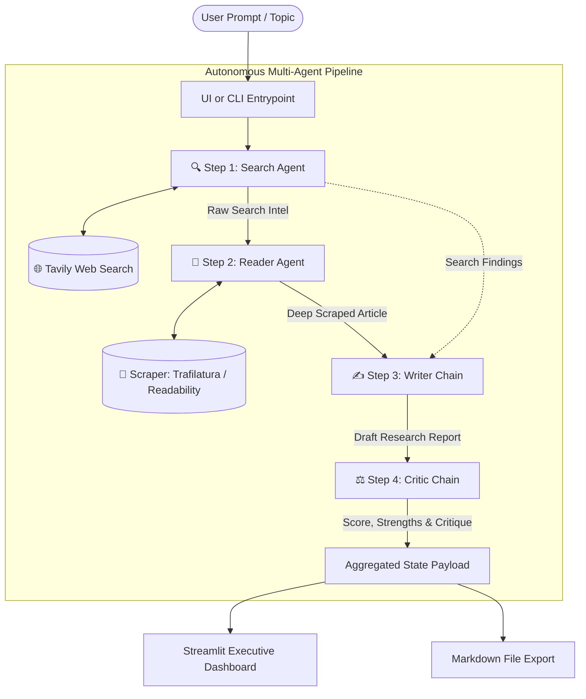

# 🏛️ System Architecture

The **Nexus Multi-Agent Research System** is an autonomous intelligence pipeline designed to gather, inspect, synthesize, and peer-review research on any topic. 

It implements a sequential multi-agent swarm architecture using **LangChain**, **LangGraph prebuilts**, **Google Gemini**, and **Tavily AI**.

---

## 📐 High-Level Architecture Diagram



---

## 🤖 The 4-Stage Agent Swarm

### 1. 🔍 Search Agent (`build_search_agent`)
- **Type**: Tool-calling ReAct agent (`langchain.agents.create_agent`).
- **Tools**: `web_search` (Tavily Search API).
- **Function**: Interprets the research topic, queries live internet sources, and extracts the top 5 high-relevance search snippets, titles, and URLs.
- **Output**: Structured summary of initial search intelligence.

### 2. 📖 Reader Agent (`build_reader_agent`)
- **Type**: Tool-calling ReAct agent (`langchain.agents.create_agent`).
- **Tools**: `scrape_url` (Trafilatura + Readability + BeautifulSoup).
- **Function**: Inspects search findings, selects the single most authoritative and comprehensive URL, and scrapes the full text body of the article.
- **Output**: Deep, cleaned text content (up to 15,000 characters) extracted from the chosen webpage.

### 3. ✍️ Writer Chain (`writer_chain`)
- **Type**: LCEL Prompt-to-LLM Chain (`writer_prompt | llm | StrOutputParser()`).
- **Function**: Takes both the initial search context and the deep scraped web content, combining them into a comprehensive, multi-section executive research report.
- **Output Structure**:
  - Executive Introduction
  - Key Findings (minimum 3 well-elaborated analytical points)
  - Strategic Conclusion & Future Outlook
  - Sources (fully cited URLs)

### 4. ⚖️ Critic Chain (`critic_chain`)
- **Type**: LCEL Evaluator Chain (`critic_prompt | llm | StrOutputParser()`).
- **Function**: Acts as a strict peer-reviewer. Evaluates factual consistency, structural depth, potential biases, and missing counter-arguments.
- **Output Structure**:
  - `Score: X/10`
  - `Strengths`: Bulleted list of notable report merits
  - `Areas to Improve`: Specific gaps, missing statistics, or assumptions
  - `One line verdict`: Executive summary verdict

---

## 🔄 State Management

The pipeline communicates via an aggregated dictionary state:

```python
state = {
    "topic": "The research query",
    "model": "gemini-3.1-flash-lite",
    "search_results": "... raw search findings ...",
    "scraped_content": "... deep article text ...",
    "report": "... final synthesized report ...",
    "feedback": "... score and critique ..."
}
```

This state is returned synchronously to callers (`main.py` or `app.py`) and stored in Streamlit's `st.session_state` for real-time inspection, tab switching, and file downloading.
