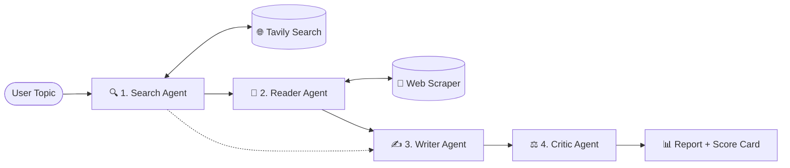

# 🔬 Nexus Multi-Agent Research System

[](https://www.python.org/)
[](https://python.langchain.com/)
[](https://aistudio.google.com/)
[](https://tavily.com/)
[](https://streamlit.io/)

An autonomous, multi-agent intelligence pipeline built with **LangChain**, **Google Gemini**, **Tavily AI**, and **Streamlit**. It coordinates specialized AI agents to scour the live web, extract in-depth webpage content, synthesize structured research dossiers, and perform rigorous peer reviews.

---

## ✨ Key Features

- 🤖 **Autonomous 4-Stage Agent Swarm**:
  1. **Search Agent**: Scours live web search results using Tavily Search API.
  2. **Deep Reader Agent**: Autonomously selects and scrapes the most authoritative URL.
  3. **Writer Agent**: Synthesizes key findings into a comprehensive structured report with citations.
  4. **Critic Agent**: Performs a strict peer-review evaluation, scores the report (`X/10`), highlights strengths, and uncovers weaknesses.
- 🌐 **Robust Multi-Tier Web Scraping**: Trafilatura engine with automatic fallback to Readability-lxml and BeautifulSoup HTML parsing.
- ⚡ **Google Gemini Native**: Configured with `gemini-3.1-flash-lite` for high token quotas, long context windows, and rapid tool calling.
- 🎨 **Executive Dark Mode Web UI**: Built with Streamlit, custom Google Fonts (`Plus Jakarta Sans`), glassmorphic containers, responsive design across Mobile, Tablet, and Desktop, live execution trackers, and one-click starter chips.
- 📥 **Export Capabilities**: Direct one-click download as Markdown (`.md`) or copy formatted report to clipboard.

---

## 🏛️ Architecture & Workflow



---

## 📁 Repository Structure

```text
multi-agent-research/
├── app.py                      # Modern Responsive Streamlit Web Application
├── main.py                     # CLI Entrypoint for automated pipeline runs
├── requirements.txt            # Python dependencies
├── .env                        # Environment credentials (API keys)
├── src/
│   ├── agents/
│   │   ├── __init__.py
│   │   └── agents.py           # Agent definitions (Search, Reader, Writer, Critic)
│   ├── pipelines/
│   │   ├── __init__.py
│   │   └── pipeline.py         # 4-stage pipeline orchestrator & callbacks
│   └── tools/
│       ├── __init__.py
│       └── tools.py            # Tavily Search & multi-tier web scraper tools
└── docs/
    ├── ARCHITECTURE.md         # Detailed system design & agent state graph
    ├── API_AND_TOOLS.md        # Technical reference for tools, scrapers & env vars
    └── PIPELINE_GUIDE.md       # Programmatic usage, callbacks & customization guide
```

---

## 🚀 Getting Started

### 1. Prerequisites
- **Python 3.11 or 3.12**
- **Google Gemini API Key**: [Get free key at Google AI Studio](https://aistudio.google.com/app/apikey)
- **Tavily Search API Key**: [Get free key at Tavily](https://app.tavily.com/)

### 2. Environment Setup

Clone or open the repository, then create and activate a virtual environment:

```powershell
# Create virtual environment
python -m venv .venv

# Activate virtual environment (Windows PowerShell)
.\.venv\Scripts\Activate.ps1
```

Install dependencies:
```powershell
pip install -r requirements.txt
```
*(Or use `uv pip install -r requirements.txt` for 10x faster installation)*

### 3. Configure API Keys

Create a `.env` file in the project root:

```env
# Google Gemini API Credentials
GEMINI_API_KEY="your_gemini_api_key_here"

# Tavily AI Search Credentials
TAVILY_API_KEY="your_tavily_api_key_here"

# (Optional) Model override (default is gemini-3.1-flash-lite)
GEMINI_MODEL="gemini-3.1-flash-lite"
```

---

## 🏃 Running the Application

### Option A: Interactive Web UI (Recommended)
Launch the responsive executive dashboard:

```powershell
streamlit run app.py
```
Open **[http://localhost:8501](http://localhost:8501)** in your browser.

- Type your research query or click a quick-starter prompt chip.
- Follow live agent execution progress in real-time.
- View and download reports with critic assessment badges.

### Option B: Command Line Interface (CLI)
Run a direct research pipeline from the terminal:

```powershell
python main.py
```

---

## 📚 Detailed Documentation

Dive deeper into individual components in the `docs/` folder:

- [🏛️ System Architecture (`docs/ARCHITECTURE.md`)](file:///c:/new/multi-agent-research/docs/ARCHITECTURE.md) – State graph, sequence flow, and agent mechanics.
- [🛠️ Tools & API Reference (`docs/API_AND_TOOLS.md`)](file:///c:/new/multi-agent-research/docs/API_AND_TOOLS.md) – Multi-tier scraper fallbacks, search schemas, and environment variables.
- [🚀 Pipeline Guide (`docs/PIPELINE_GUIDE.md`)](file:///c:/new/multi-agent-research/docs/PIPELINE_GUIDE.md) – Programmatic usage, status callbacks, and customization tips.

---

## 📄 License
MIT License. Open-source for research, development, and commercial exploration.
